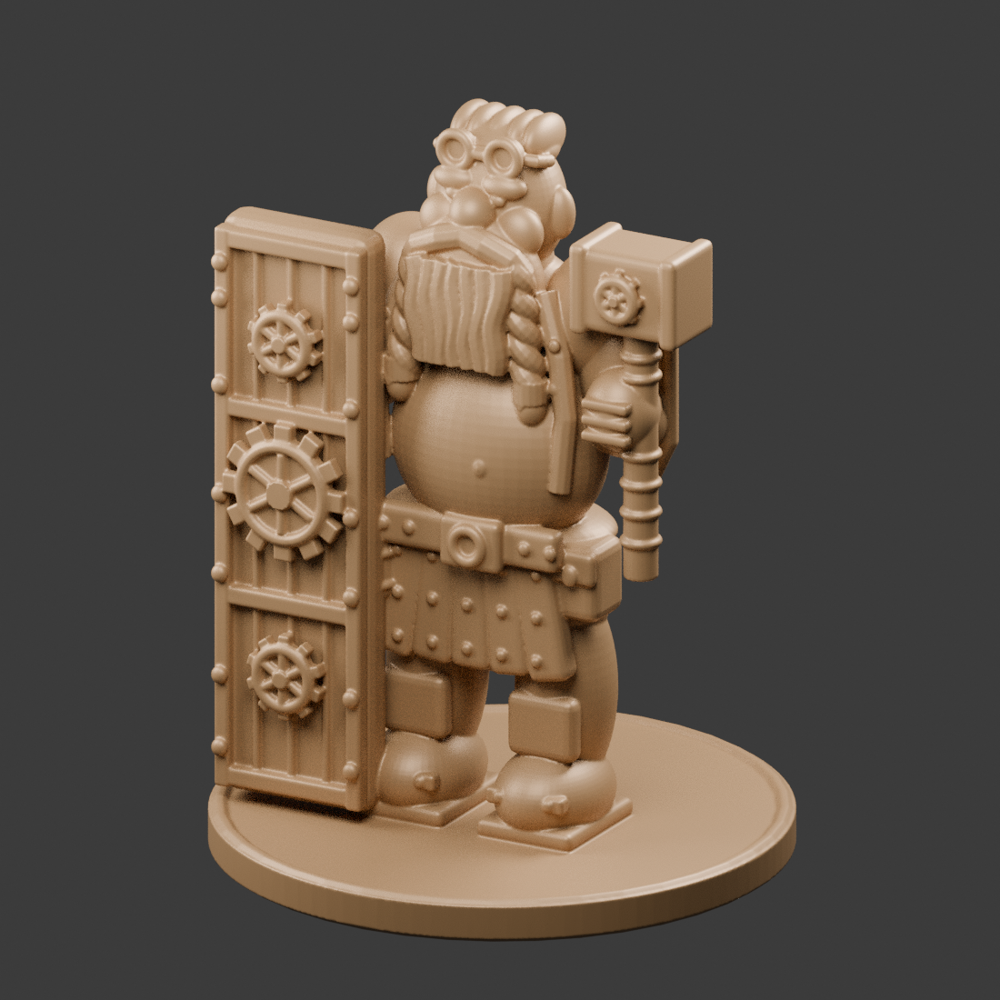

# Gearshield dwarf miniature

A stylized, reference-inspired dwarf miniature for filament printing: braided beard,
goggles, gear-covered tower shield, steam hammer, and belt equipment.



## Download

- [Printable STL](https://github.com/Gerrit5379/TEST-for-GPT/raw/refs/heads/main/gearshield_dwarf_50mm.stl)
- [Complete ZIP package, including editable Blender files](https://github.com/Gerrit5379/TEST-for-GPT/raw/refs/heads/main/gearshield-dwarf-package.zip)
- [Printing instructions](PRINTING.md)

If GitHub displays a file page instead of downloading, click **Download raw file**.
Alternatively, use **Code → Download ZIP** on the repository page.

## Printing

Approximately 50 mm figure above its base, 53 mm total height; 40 mm base diameter.
Start with a 0.4 mm nozzle, 0.10–0.12 mm layers, and organic/tree supports. See
[PRINTING.md](PRINTING.md) for orientation, support areas, and limitations.

The exported STL was independently reimported and checked: one connected closed
mesh, no non-manifold edges, positive signed volume, and 53 mm total height.
It has not been sliced for a specific printer or physically test-printed.

## Editable model and generation

The complete ZIP includes the final Blender scene and the editable construction
scene, as well as the STL, previews, instructions, generation script, and checks.
To regenerate with Blender 4.3 or newer:

```sh
blender --background --threads 4 --python create_dwarf.py
```
