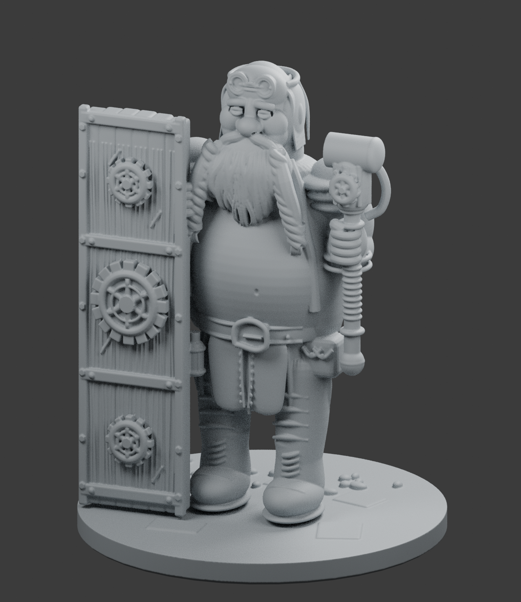

# Gearshield dwarf — detailed revision

A rebuilt procedural sculpt inspired by the supplied dwarf reference. This is
a more detailed, less blocky interpretation; it remains stylized and does not
match the realism of a professional hand-sculpted or scanned character.



## Download

- [Printable STL](https://github.com/Gerrit5379/TEST-for-GPT/raw/refs/heads/main/detailed-v2/gearshield_dwarf_v2_50mm.stl)
- [Complete package, including editable Blender files](https://github.com/Gerrit5379/TEST-for-GPT/raw/refs/heads/main/detailed-v2/gearshield-dwarf-v2-package.zip)
- [Printing notes and limitations](PRINTING.md)
- [Straight-on view](preview_v2_front.png)
- [Face and beard close-up](preview_v2_portrait.png)

If a file opens in GitHub, use **Download raw file**. The original model remains
at the repository root; this revision is separate so you can compare the two.

## Changes from the first model

- Continuous torso and facial sculpt, with eye sockets, eyelids, nostrils,
  cheek folds, ear recesses, and a recessed navel.
- Receding swept-back hair, tapered beard locks with strand relief, and
  three-strand side braids with ferrules.
- Layered jacket shoulders, shaped coat panels, cloth compression folds,
  split apron, leather seams, boot laces, pouch details and belt buckle.
- Timber shield planks and grain, metal braces, peened rivets, concentric
  gearwork, bolts and raised wear relief.
- Rounded pressure-chamber weapon with mechanical ribs, collars, valve face
  and return pipe; articulated gripping fingers.

All previews render the actual mesh in uniform grey clay. No texture or generated
concept art is being substituted for modeled detail.

## Scale and printing limits

53 mm total height, including the base; approximately 40 mm base diameter.
For a 0.4 mm nozzle, start with 0.10–0.12 mm layers and organic/tree supports.
Some fine surface relief will disappear or soften at this size. A 0.2 mm nozzle
or a larger print will capture more detail. This is not a tested printer profile,
and the model has not been physically test-printed.

The STL is independently reimported and checked for one closed connected shell,
zero non-manifold edges, positive signed volume and expected dimensions. These
checks do not establish physical print success or a particular artistic quality.

## Edit or regenerate

The complete package contains the final and component-based Blender scenes,
the STL, previews, printing notes, generation and validation scripts, and the
digital validation results. Regenerate with Blender 4.3 or newer:

```sh
blender --background --threads 4 --python sculpt_dwarf.py
```
