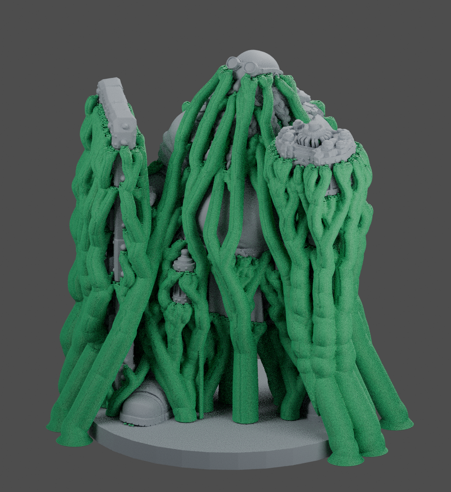
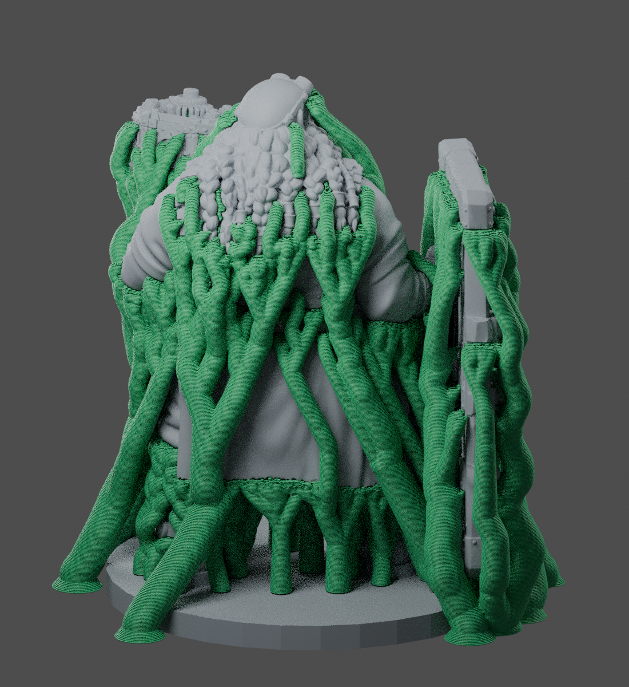

# Gerrit — 0.2 mm nozzle, fine-detail Creality Print projects

For **Creality CR-10S Pro V2, 0.2 mm nozzle, standard PLA**, retaining the original
uploaded character's full surface geometry and upright orientation.

## Download

- [76 mm project](https://github.com/Gerrit5379/TEST-for-GPT/raw/refs/heads/main/gerrit-02mm/Gerrit_76mm_0p2nozzle.3mf)
- [152 mm project](https://github.com/Gerrit5379/TEST-for-GPT/raw/refs/heads/main/gerrit-02mm/Gerrit_152mm_0p2nozzle.3mf)
- [Small support-removal test](https://github.com/Gerrit5379/TEST-for-GPT/raw/refs/heads/main/gerrit-02mm/Support_Gap_Test_0p2.3mf) — approximately 90 minutes and 1.3 g PLA
- [Complete settings and optional ultra-fine mode](SETTINGS.md)
- [Validation results and print estimates](VALIDATION.md)

Heights include the base. Open a 3MF **as a project**, keeping its included
printer, process and filament settings, then click **Slice Plate**. The supports
regenerate from the included settings; they are not permanently baked into an STL.

Before slicing, confirm:

- Printer: **CR-10S Pro V2 0.2 mm - Gerrit Detail**.
- Nozzle diameter: **0.2 mm**.
- Process: **Gerrit 0.2 nozzle - 0.06 Fine Detail**.
- Filament: **Gerrit PLA - 0.2 nozzle**.

The printer preset is a custom derivative of Creality's stock CR-10S Pro V2
profile, with the nozzle diameter and layer-height limits changed explicitly.
It retains the printer's build volume, machine geometry, and start/end G-code.
This is a true 0.2 mm setup, rather than a smaller layer height on a 0.4 mm setup.

## Print estimates

| Height | Estimated duration | PLA |
|---|---|---|
| 76 mm | 2d 8h 17m 26s | 37.20 g |
| 152 mm | 9d 22h 20m 13s | 184.65 g |

These are slicer estimates for the main 0.06 mm projects.

## Detail and surface finish

The primary projects use **0.06 mm layers, approximately 0.22 mm line widths,
4 walls, slower outer walls, and organic supports matched to the finer nozzle**.
No smoothing, decimation, voxel remeshing or removal of the original sculpt's
detail was applied. Nozzle size changes what can be resolved; it cannot add
detail missing from the original model.

The 152 mm version gives fine features more physical room to resolve. The 76 mm
version uses less time and material, but thin relief may still merge or disappear.
For an intermediate height, use uniform scaling and reslice the project.

The optional **0.04 mm Ultra Fine** process JSON is included for further Z-layer
smoothing. Import it with the supplied 0.2 mm printer active, select it and
reslice. It was checked on a 10 mm cube; the full character's optional 0.04 mm
slice and print have not been validated. It does not improve XY nozzle resolution
over the 0.06 mm setup, and lower layers are not automatically better on an
uncalibrated printer.

## Removal and calibration

Start with the included **Support_Gap_Test_0p2.3mf** if this is your first print
with the new nozzle. It is a 22 × 16 × 11.1 mm supported cantilever with 0.3,
0.4 and 0.5 mm raised bars on its top. It uses the same 0.06 mm layer, nozzle,
PLA, support-interface and contact-gap settings as the character. Inspect its
first layer, raised detail, supported underside and support removal before the
much longer character print. Its slice succeeded; it has not been test-printed.

Supports use smaller 0.6 mm tips, 0.16 mm contact gaps and 0.25 mm XY clearance.
The branches have two thin support walls for stability with the finer extrusion.
Cut tree trunks into sections and support each delicate feature while removing
its contacts. Avoid pulling a large tree against beard strands or fingers.

After fitting the new nozzle, recheck your Z-offset, first layer, PLA flow,
temperature and retraction. Digital slicing does not prove physical removal,
zero support marks or optimal flow on your particular nozzle. The contact gap
is a removable-support starting point; test a small supported piece before a
multi-day print. See SETTINGS.md for targeted adjustments.

Green shows actual generated support extrusion paths, sampled every third
combined layer for rendering; grey is the original character mesh. These are
toolpath illustrations, not photographs or a physical print-quality prediction.
