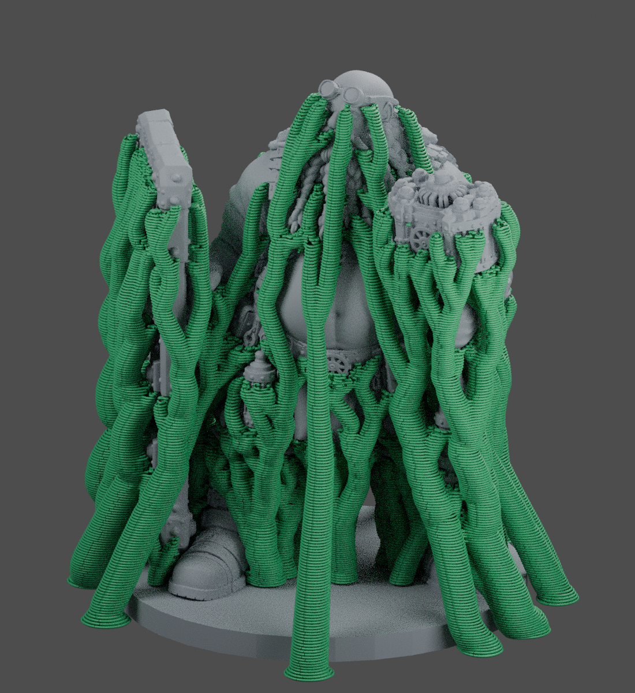
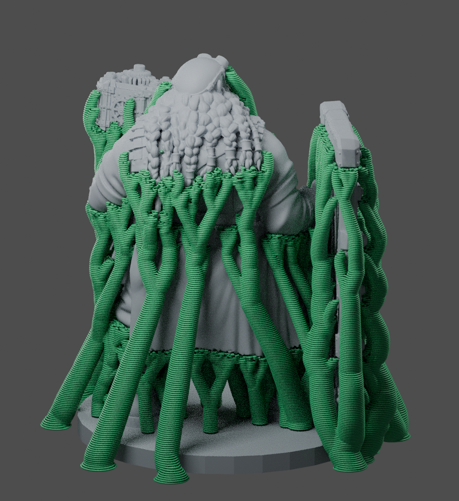

# Gerrit — Creality Print support projects

Prepared for a **Creality CR-10S Pro V2, stock Bowden setup, 0.4 mm nozzle,
standard PLA**, using the official Creality Print **7.3.0.6157** Linux build and
its CR-10S Pro V2 machine profile.

## Download and open

- [76 mm project](https://github.com/Gerrit5379/TEST-for-GPT/raw/refs/heads/main/gerrit-supported/Gerrit_76mm_CrealityPrint.3mf)
- [152 mm project](https://github.com/Gerrit5379/TEST-for-GPT/raw/refs/heads/main/gerrit-supported/Gerrit_152mm_CrealityPrint.3mf)
- [Settings and removal instructions](SETTINGS.md)
- [Digital validation and comparison](VALIDATION.md)

| Total height, including base | Slicer time estimate | Total PLA estimate |
|---|---|---|
| 76 mm | 19 h 28 min | 46.82 g |
| 152 mm | 80 h 5 min | 239.55 g |

The slimmer trunks reduce estimated support PLA by about 34% at 76 mm and 29%
at 152 mm relative to the same setup using 5° trunk growth. These are digital
comparisons, not physically measured printing or removal results.

Open either **as a project**, keeping the included printer, filament and process
settings. Check that the printer is **Creality CR-10S Pro V2 0.4 nozzle**, process
is **Gerrit 0.12mm organic_refined**, and filament is **Gerrit standard PLA 200C**.
Click **Slice Plate** and inspect **Preview** before exporting to your printer.

Optional standalone presets are included as `Gerrit_Detail_Supports.json` and
`Gerrit_Standard_PLA.json` for reuse. The projects already contain their settings;
you do not need to import the JSON files to use these two projects.

These are editable slicer projects: the support settings are included and the
trees regenerate when you slice. Supports are not permanently fused into an STL.
The original model's surface geometry was retained, with scale and placement set
for printing. The small source mesh defects did not prevent the tested slices.

Both heights include the base. To print an intermediate height, enable uniform
scaling, set the desired total Z height, and slice again. Do not scale the
already-generated G-code.

## Orientation and surface finish

The character stands upright with its flat circular base on the plate. Tilting
the complete figure would sacrifice more visible surfaces to support contact
and require supporting the underside of its broad base.

The 152 mm version offers more room for the beard strands, gearwork, fingers and
clothing relief to resolve with a 0.4 mm nozzle. The 76 mm version uses much less
material and time, but some small details will merge or disappear.

Green shows the **actual 76 mm generated support toolpaths**, sampled every third
layer for rendering; grey is the model. Use Creality Print's layer preview for
the complete toolpaths. The pictures are not a separate, invented support mesh.

The supports reach under the weapon, hands, beard, lantern and clothing. Organic
branches may start on the model's base where required to reach internal
overhangs; restricting everything to the bed can make those areas harder to
reach. Inspect access for removal behind the shield and inside the beard.

## Important limits

The projects have been reopened and sliced in Creality Print, including G-code
export, and the effective settings in the generated toolpaths were checked.
They have **not** been physically test-printed. Digital slicing cannot establish
actual removal force, support marks, PLA flow accuracy, or adhesion on your
specific machine. The support gap is an easy-removal starting point, not a
guarantee of mark-free surfaces.

Raw machine G-code is not included in this download: generate it in your own
Creality Print installation after confirming your active printer, PLA and bed
level/Z-offset setup. The projects retain the official machine start/end code.
